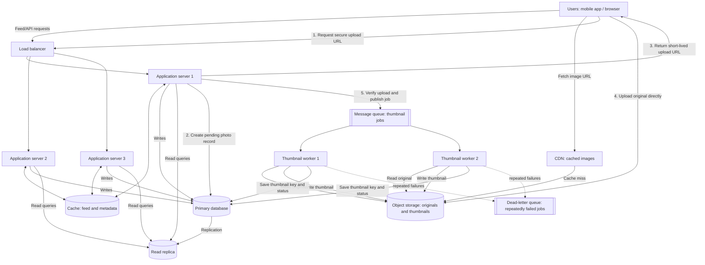

# SnapShare Photo App Scaling Plan

## 1. Introduction

SnapShare is a photo-sharing application where users upload photos and scroll through a feed containing photos from people they follow. As the number of users increases, the system must handle photo uploads, feed requests, image storage, and thumbnail generation efficiently.

The goal of this scaling plan is to design an architecture that supports high traffic, stores photos reliably, and provides a fast experience for users.

## 2. Assumptions

The following assumptions are used for the calculations:

- Registered users: 10,000,000.
- Daily active users: 10% of registered users.
- Each daily active user uploads one photo per day.
- Each daily active user views 50 feed pages per day.
- Average original photo size: 2 MB.
- Each thumbnail size: 50 KB.
- A year contains 365 days.
- Average traffic is calculated over 86,400 seconds per day.
- Peak traffic is estimated at five times the average traffic.
- Every uploaded photo generates one thumbnail.
- All original photos and thumbnails are retained for one year, with no deletion or compression beyond the stated sizes.
- The storage estimates exclude database backups, replication overhead, logs, and other application data.

## 3. Traffic and Storage Calculations

### 3.1 Daily Active Users

Daily active users are 10% of the 10 million registered users.

Daily active users = 10,000,000 × 10%

**Daily active users = 1,000,000 users.**

### 3.2 Photo Uploads Per Second

Each daily active user uploads one photo per day.

Daily uploads = 1,000,000 × 1

Daily uploads = 1,000,000 photos.

Average uploads per second = 1,000,000 ÷ 86,400

**Average uploads per second ≈ 11.57 photos.**

Peak uploads per second = 11.57 × 5

**Estimated peak uploads per second ≈ 57.87 photos.**

### 3.3 Feed Views Per Second

Each daily active user views 50 feed pages per day.

Daily feed views = 1,000,000 × 50

Daily feed views = 50,000,000 feed page requests.

Average feed views per second = 50,000,000 ÷ 86,400

**Average feed views per second ≈ 578.70 requests.**

Peak feed views per second = 578.70 × 5

**Estimated peak feed views per second ≈ 2,893.52 requests.**

These calculations count feed page requests, not individual photos displayed or image downloads.

### 3.4 Photo Storage Per Year

Each original photo occupies 2 MB, and each thumbnail occupies 50 KB.

Assuming decimal storage units:

- Original photo storage per day = 1,000,000 × 2 MB = 2,000,000 MB = 2 TB.
- Thumbnail storage per day = 1,000,000 × 50 KB = 50,000,000 KB = 50 GB.
- Total image storage per day = 2 TB + 50 GB = 2.05 TB.

Original photo storage per year:

2 TB × 365 = **730 TB**.

Thumbnail storage per year:

50 GB × 365 = **18.25 TB**.

Total new image storage per year:

730 TB + 18.25 TB = **748.25 TB per year**.

Therefore, SnapShare needs approximately **748.25 TB of additional image storage each year**, before accounting for backups, replicas, and other overhead. The estimate assumes every active user uploads one photo every day throughout the year.

## 4. Is SnapShare Read-Heavy or Write-Heavy?

SnapShare is primarily a **read-heavy system** because users view 50 feed pages per day but upload only one photo per day.

Daily feed views = 50,000,000 requests.

Daily photo uploads = 1,000,000 photos.

The ratio is 50 feed page requests for every photo upload. Although each upload also creates storage and background-processing work, feed requests greatly outnumber upload requests.

This means the architecture should optimize feed delivery, database reads, caching, and image delivery. A cache and database read replica can reduce pressure on the main database, while a Content Delivery Network (CDN) can serve frequently requested images from locations closer to users.

## 5. Why Photos Should Not Be Stored Inside the Database

Original photos and thumbnails should be stored in object storage rather than directly inside database rows.

Storing large image files in the database would increase database size, make backups and restores heavier, and consume resources that should be used for structured data and queries. It would also make image delivery and independent storage scaling more difficult.

Instead, object storage should hold the original images and thumbnails, while the database stores metadata such as photo ID, owner ID, caption, upload time, object-storage key, and thumbnail key. This separation allows image storage to scale independently from user accounts, relationships, and feed metadata.

## 6. Proposed Architecture Diagram

The architecture separates the **synchronous API path** (which should respond quickly) from **asynchronous thumbnail processing** (which can take longer and be retried independently).



### Diagram notes

- **Users** access the API through the load balancer. The load balancer distributes requests across multiple application servers.
- **Direct upload:** the application issues a short-lived, permission-limited upload URL; the client sends the image bytes directly to object storage.
- **Message queue:** the application adds a thumbnail job only after the original upload has been verified. The queue buffers bursts and decouples the upload response from image processing.
- **Thumbnail workers:** multiple workers can consume queued jobs in parallel. They read originals and write thumbnails in object storage, then update the photo record in the primary database.
- **Database:** the primary database accepts writes; the read replica serves suitable read traffic. Replication can lag, so critical reads immediately after a write may need the primary.
- **CDN:** it serves cached images and retrieves uncached images from object storage. Private images should use authorized or signed delivery URLs.
- **Reliability:** application servers, workers, and storage should be deployed with health checks, monitoring, retries, and appropriate redundancy. The queue should support a dead-letter queue for jobs that repeatedly fail.

## 7. Architecture Components: One-Sentence Summaries

1. **Users (mobile app/browser):** Users upload photos, request feed data, and view images through the client application.
2. **Content Delivery Network (CDN):** The CDN serves cached photos and thumbnails from locations closer to viewers, reducing latency and requests to object storage.
3. **Load balancer:** The load balancer distributes incoming API requests across healthy application servers so that no single server handles all the traffic.
4. **Application servers:** Application servers authenticate users, validate upload requests, manage photo metadata and permissions, and generate feed responses.
5. **Cache:** The cache temporarily stores frequently requested feed data and metadata to reduce repeated database queries and improve response time.
6. **Primary database:** The primary database stores structured records such as users, follows, photo metadata, captions, and processing status, and handles writes.
7. **Database read replica:** The read replica serves suitable read queries to reduce load on the primary database, while acknowledging that replication can lag behind writes.
8. **Object storage:** Object storage holds original image files and generated thumbnails separately from the relational database and scales to accommodate large files.
9. **Message queue:** The message queue durably buffers thumbnail-generation jobs so uploads can finish without waiting for slower background processing.
10. **Thumbnail workers:** Thumbnail workers consume queued jobs, read originals from object storage, generate smaller images, save them, and update photo metadata.
11. **Dead-letter queue (DLQ):** The DLQ holds jobs that repeatedly fail so they can be inspected, corrected, and safely replayed instead of being retried indefinitely.

## 8. Asynchronous Photo Upload and Thumbnail Workflow

The upload request and thumbnail generation are separate tasks. The user should not have to keep an API request open while the system resizes an image. The API confirms the original upload, queues a job, and returns a response; a background worker creates the thumbnail later.

### 8.1 Upload and queueing

1. **User selects a photo.** The client checks basic constraints, then asks SnapShare to start an upload.
2. **Request reaches the application.** The load balancer sends the request to a healthy application server. The server authenticates the user and checks upload permissions, file type, file size, and rate limits.
3. **Create a pending record.** The application creates a photo record in the primary database with a unique photo ID, owner ID, object key, and status such as `upload_pending` or `processing`.
4. **Issue secure upload permission.** The application returns a short-lived, restricted upload URL (for example, a presigned object-storage URL). It should permit only the intended object and allowed operation.
5. **Client uploads the original.** The client sends the image directly to object storage. This keeps large file traffic off the application servers.
6. **Verify the stored object.** The client reports completion, or an object-storage event notifies the application. The application verifies the object exists and checks relevant properties such as size and content type. It must not trust a client completion message without verification.
7. **Publish a thumbnail job.** After verification, the application publishes a message to the queue. The message should contain identifiers and storage keys, for example:

   ```json
   {
     "jobType": "generate_thumbnail",
     "photoId": "photo_12345",
     "ownerId": "user_789",
     "originalKey": "originals/photo_12345",
     "attempt": 1
   }
   ```

   The message contains references to the image, not the image bytes themselves. The queue acknowledges durable acceptance according to its delivery guarantees.
8. **Respond to the user.** The API returns a success/accepted response indicating that the original was uploaded and thumbnail processing is pending. The interface can show “Photo uploaded — preparing thumbnail.”

### 8.2 Background thumbnail worker

9. **Worker receives the job.** An available thumbnail worker consumes a message from the queue. It should acknowledge the job only after the required processing and database update have succeeded.
10. **Check the job and original.** The worker validates the message, checks that the photo record exists, and reads the original image from object storage. It checks that the file can be decoded and is within processing limits.
11. **Generate the thumbnail.** The worker resizes the image to the required dimensions, preserves the intended aspect ratio, and encodes the output in the chosen image format.
12. **Store the thumbnail.** The worker writes the thumbnail to a deterministic object key such as `thumbnails/photo_12345.webp`. A deterministic key helps retries replace or reuse the same output rather than creating duplicates.
13. **Update metadata.** The worker updates the photo record with the thumbnail key, processing status `ready`, and completion time. The database update should be idempotent so that processing the same job more than once does not create inconsistent records.
14. **Acknowledge the message.** After the thumbnail is stored and the metadata update succeeds, the worker acknowledges the queue message so it is removed from normal processing.
15. **Make the image available.** The feed API can return the original and thumbnail URLs or keys according to the photo's publishing and privacy rules. The CDN serves the thumbnail to viewers and caches it when allowed.

### 8.3 Failures, retries, and duplicate messages

- **Temporary failure:** if object storage or the database is temporarily unavailable, the worker does not acknowledge the message. The queue can redeliver it, preferably with delayed retries and backoff.
- **Repeated failure:** after a configured retry limit, the job moves to a **dead-letter queue (DLQ)**. Operators can inspect the reason, fix the underlying problem, and replay the job when safe.
- **Duplicate delivery:** queues may deliver a message more than once. Workers should be idempotent: use the photo ID as a stable job identifier, write to a deterministic thumbnail key, and avoid repeating non-idempotent side effects.
- **Worker crash:** if a worker crashes before acknowledging the job, the queue makes the job available again after its visibility or lease timeout.
- **Upload succeeds but queue publishing fails:** the photo should remain in a recoverable state such as `uploaded_processing_pending`. Use a transactional outbox, durable upload-completion event, or scheduled reconciliation process to publish the missing job rather than silently losing the work.
- **Original upload fails or is abandoned:** mark the upload as failed or expired and clean up incomplete objects and stale pending records using a scheduled cleanup process.
- **Thumbnail is delayed:** the application should display a processing state or use a suitable fallback image. Do not report thumbnail processing as complete until the worker has stored the output and updated the metadata.

This design lets the application accept uploads without waiting for thumbnail generation. During traffic spikes, jobs wait safely in the queue, and more workers can be added to reduce the backlog. Monitor queue depth, oldest-job age, processing duration, retry counts, DLQ size, and the percentage of thumbnails successfully generated.

## 9. Scaling and Reliability Considerations

- **Horizontal scaling:** Add application servers when API traffic increases, instead of depending on one increasingly powerful server.
- **Cache strategy:** Cache popular feed metadata and frequently accessed images, and invalidate or refresh affected entries when necessary.
- **Database scaling:** Use a primary database for writes and a read replica for suitable reads, while monitoring replication lag.
- **Asynchronous processing:** Add thumbnail workers when the queue grows, and monitor queue length, processing latency, and failed jobs.
- **Storage lifecycle:** Monitor annual storage growth and consider lifecycle policies, compression, or archival tiers where appropriate.
- **Observability:** Track request latency, error rates, upload failures, cache hit rates, database performance, and queue delays.

## 10. Trade-Offs

### Trade-Off 1: Caching Versus Data Freshness

Caching improves feed response times and reduces database load, but cached information can become outdated. SnapShare should use suitable expiration times and targeted cache invalidation so that important updates, such as new photos or changed privacy settings, are reflected promptly.

### Trade-Off 2: Asynchronous Thumbnail Processing Versus Immediate Availability

Using a queue makes uploads faster because the user does not need to wait for thumbnail generation. However, thumbnails may not be available immediately, and queue failures or worker delays can postpone processing. SnapShare should show a processing state, retry temporary failures, and monitor queue health.

### Trade-Off 3: Database Read Replicas Versus Strongly Consistent Reads

A read replica increases read capacity, but replication is not always instantaneous. Recently uploaded photos or updated metadata may not immediately appear in queries served by the replica. SnapShare can route critical reads to the primary database or temporarily use primary reads after important writes.

### Trade-Off 4: Direct Object Storage Uploads Versus More Complex Upload Management

Direct uploads reduce application-server bandwidth and improve scalability. However, they require secure upload URLs, validation, expiration rules, and cleanup of incomplete uploads. SnapShare must also verify successful uploads before publishing a photo.

## 11. Conclusion

SnapShare should use a horizontally scalable application tier, a CDN, caching, a primary database with a read replica, object storage, and a queue-based thumbnail-processing system.

With one million daily active users, the initial estimates are approximately 11.57 average photo uploads per second, 578.70 average feed page requests per second, and 748.25 TB of new original-photo and thumbnail storage per year. Because feed requests outnumber uploads by approximately 50 to 1, the design should prioritize fast reads and efficient image delivery while ensuring that uploads and thumbnail jobs remain reliable as the application grows.